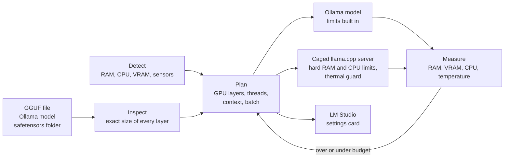

<p align="center">
  
</p>

<h1 align="center">𓆄𓅱 &nbsp;Shu</h1>

<p align="center">
  <b>Run big GGUF models on a small, fixed share of your machine.</b><br>
  Pick a budget (say 30% of your RAM, CPU and GPU) and Shu makes the model stay inside it,<br>
  for <b>Ollama</b>, <b>llama.cpp</b> and <b>LM Studio</b>. Then it measures the result to prove it.
</p>

<p align="center">
  <a href="https://github.com/Lord1Egypt/Shu/actions/workflows/tests.yml"></a>
  
  
  
  
</p>
<p align="center">
  
  
  
  
  
  
</p>

---

## Why

A local model normally takes whatever it can get: all your VRAM, every core, and
enough heat to turn a laptop into a hand warmer. Shu turns that around. You say
how much of the machine the model may use, and Shu:

- **reads the model** (pure-Python GGUF parser) to learn the exact size of every layer;
- **plans the load**: how many layers fit in the VRAM budget, how many threads, how much context;
- **loads it partially**: only the planned layers go to the GPU, the rest is memory-mapped, so a model larger than the RAM budget still runs by paging from disk;
- **enforces the budget** with a kernel cage (cgroup v2) that the model cannot exceed, with no root needed, and reads the limits back to confirm they are in force;
- **guards the temperature** from the moment the engine starts: it freezes the engine when the GPU or CPU gets too hot and thaws it when it cools;
- **measures the real run** and retunes itself until the numbers are inside the budget. A value it could not measure is reported as not measured, never as a pass.

No Python packages to install. The core is the standard library only.

## Measured results

Real runs on a laptop: **Intel i7-9750H (6 cores), 12.7 GiB RAM (WSL2), NVIDIA RTX 2060 6 GiB**,
Ollama 0.40 with its bundled llama.cpp. Every number below was measured by `shu bench` /
`shu apply --verify`, not estimated.

| Model | Size | Budget | Engine | RAM used / limit | VRAM used / limit | CPU cores used / limit | GPU peak | Speed |
|---|---|---|---|---|---|---|---|---|
| Qwen3.5 4B Q4_K_M + vision | 3.1 GiB | 30% | Ollama model | 2.83 / 3.80 GiB | 1.75 / 1.80 GiB | 2.7 / 3.6 | 60 °C | 6.59 tok/s |
| Qwen3.5 4B Q4_K_M | 2.5 GiB | 25% | caged llama.cpp | 2.66 / 3.17 GiB | 1.36 / 1.50 GiB | 2.0 / 3.0 | 60 °C | 5.68 tok/s |
| Qwen3.5 4B Q4_K_M | 2.5 GiB | 30% | caged llama.cpp | 2.18 / 3.80 GiB | 1.69 / 1.80 GiB | 3.0 / 3.6 | 61 °C | 6.16 tok/s |
| Qwen3.5 4B Q4_K_M | 2.5 GiB | 35% | caged llama.cpp | 1.85 / 4.43 GiB | 2.02 / 2.10 GiB | 3.6 / 4.2 | 62 °C | 7.07 tok/s |
| Qwen3.5 4B requantized to Q3_K_M | 2.1 GiB | 30% | caged llama.cpp | 2.66 / 3.80 GiB | 1.73 / 1.80 GiB | 1.4 / 3.6 | 62 °C | 3.06 tok/s |
| Gemma 4 E4B 7.5B Q4_K_M | 5.0 GiB | 30% | caged llama.cpp | 3.50 / 3.80 GiB | 1.55 / 1.80 GiB | 2.8 / 3.6 | 61 °C | 4.41 tok/s |
| SmolLM2 135M Q4_K_M (from safetensors) | 0.1 GiB | 30% | caged llama.cpp | 0.60 / 3.80 GiB | 0.30 / 1.80 GiB | 1.0 / 3.6 | 60 °C | 76.94 tok/s |

The requantized Q3_K_M model fit the budget but ran slower than Q4_K_M on this machine (3.1 vs 6.2 tokens/s); the cause is not yet diagnosed.

## Honest expectations for very large models

Shu makes a model **fit**. It cannot make a model that is ten times larger than
your memory **fast**: every weight that does not fit in RAM is read from disk
again for each token. Shu tells you this before you wait for it.

Measured example: the 5.0 GiB model above, squeezed into a 2 GiB RAM cage with 1 GiB of VRAM, stayed inside the limit but produced about one token every 35 seconds (measured with an earlier cage setting that has since been changed; not yet re-measured). For a 70B model at Q4_K_M (about 42 GiB) on this laptop, `shu plan` reports roughly 38 GiB re-read from disk per token, which means minutes per token.

The rule of thumb: a model runs at a useful speed when its file is at most about
as large as the RAM plus VRAM you give it. Beyond that it still runs, inside the
budget, at disk speed. `shu plan` prints the estimate for your model and budget,
and suggests a smaller quantization when one would fit.

## Install

```bash
git clone https://github.com/Lord1Egypt/Shu.git
cd Shu
python3 -m shu            # run from the checkout, or:
pip install .              # installs the `shu` command
```

Requirements: Linux or WSL2, Python 3.10 or newer, and an engine: either
[Ollama](https://ollama.com) (which bundles llama.cpp's server and quantizer) or
[llama.cpp](https://github.com/ggml-org/llama.cpp) on your `PATH`.
An NVIDIA GPU is optional; without one Shu plans CPU-only.

## Quick start

```bash
shu                                   # interactive wizard: model, budget, action
```

Or directly:

```bash
shu plan  qwen3.5:4b --percent 30                 # what would fit, and how
shu apply qwen3.5:4b --percent 30 --verify        # create a limited Ollama model, measure, tune
ollama run qwen3.5-4b-shu                         # use it like any Ollama model

shu serve Thoth:latest --percent 30 --max-temp 80 # caged llama.cpp server, hard limits
shu bench Thoth:latest --percent 30               # one measured run against the budget
```

Set each limit yourself instead of a percentage:

```bash
shu apply my-model.gguf --ram 4 --vram 2 --cpu 3 --ctx 8192 --max-temp 75
```

### What the plan looks like

```text
$ shu plan Thoth:latest --percent 30

  Model            Gemma 4 E4B It Ultra Uncensored Heretic
  Parameters       7.52 B
  Quantization     Q4_K_M (5.66 bits per weight)
  Size on disk     4.97 GiB
  Layers           42 (about 55 MiB each)
  Projector        946 MiB (vision/audio, BF16)

  OVERSIZED: the weights exceed the RAM budget and will be paged from disk

  Resource  Budget     Planned    Detail
  --------  ---------  ---------  -----------------------------------
  RAM       3.80 GiB   6.06 GiB   working 1.87 GiB + weights 4.19 GiB
  VRAM      1.80 GiB   1.78 GiB   15 of 43 layers on the GPU
  CPU       3.6 cores  3 threads

  Settings: num_gpu=15  num_thread=3  num_ctx=4096  num_batch=512  use_mmap=true
  - Only the embedding tables exceed the RAM budget. They are read a few rows at a time, so the slowdown is small.
  - Only a caged engine (`shu serve`) can hold RAM to the budget in this mode.
  - Requantizing to Q2_K (about 2.63 GiB) would fit entirely in the budget.
```

## Commands

| Command | What it does |
|---|---|
| `shu` / `shu wizard` | Interactive setup: choose a model, a budget and an action |
| `shu detect` | Show the CPU, RAM, GPU, sensors and engines Shu found |
| `shu inspect MODEL` | Show what is inside a model: layers, sizes, quantization |
| `shu plan MODEL` | Compute the settings that keep the model inside the budget |
| `shu apply MODEL` | Create an Ollama model with the limits built in; `--verify` measures and retunes |
| `shu bench MODEL` | Run once and compare real RAM, VRAM, CPU and temperature with the budget |
| `shu serve MODEL` | Serve from a caged llama.cpp server (OpenAI-compatible API) with hard limits |
| `shu convert MODEL` | Convert safetensors to GGUF, requantize, import into Ollama |
| `shu setup-converter` | One-time install of the safetensors converter (PyTorch, about 1 GB) |

Budget options, shared by `plan`, `apply`, `bench` and `serve`:

| Option | Meaning |
|---|---|
| `--percent N` | Share of RAM, VRAM and CPU (default 30) |
| `--ram GB`, `--vram GB`, `--cpu THREADS` | Set one limit exactly; overrides the percentage |
| `--ctx TOKENS` | Context length (default: up to 4096; reduced automatically if it cannot fit) |
| `--batch TOKENS` | Batch size (default 512) |
| `--max-temp C` | Pause the caged engine at this temperature, resume 5 degrees below |
| `--text-only` | Leave out a vision/audio projector to save memory |
| `--unload-others` | (`bench`, `apply --verify`) allow unloading other models Ollama has loaded |
| `--json` | Machine-readable output |

`shu bench` and `shu apply --verify` can gate a script through their exit code:

| Exit code | Meaning |
|---|---|
| 0 | Every value was measured and is inside the budget |
| 2 | At least one value is over the budget |
| 3 | Nothing is over, but something could not be measured, so the budget is not confirmed |

Shu never unloads a model you did not ask it to. If Ollama has other models loaded,
a measurement stops and says so; pass `--unload-others` to allow it.

## Model types

| You have | Shu does |
|---|---|
| A `.gguf` file | Reads it directly. Split models (`-00001-of-00003.gguf`) are read as one. |
| An Ollama model (`qwen3.5:4b`, `hf.co/user/repo:Q4_K_M`) | Finds the GGUF files behind the name, including a vision projector |
| A Hugging Face **safetensors** folder | `shu convert DIR --quant Q4_K_M` turns it into a quantized GGUF |
| A model that is too big for the budget | `shu convert MODEL --quant Q3_K_M` requantizes it smaller |

```bash
shu setup-converter                                         # once
shu convert ./SmolLM2-135M-Instruct --quant Q4_K_M --name smollm2   # safetensors -> GGUF -> Ollama
shu convert qwen3.5:4b --quant Q3_K_M --name qwen3.5-q3             # shrink an Ollama model
```

Requantizing an already quantized model loses more quality than quantizing from
the original 16-bit weights. When you can, convert from the safetensors original.

## How it works



| Resource | How the limit is applied | Enforced by |
|---|---|---|
| **VRAM** | Only as many layers as fit are sent to the GPU (`num_gpu`); `--verify` corrects the count from a real measurement | llama.cpp, verified by measurement |
| **RAM** | Weights are memory-mapped; in `shu serve` a cgroup caps the process at the budget, and the kernel evicts and re-reads model pages instead of growing. The model is dropped from the page cache first, so every page it uses is charged to the cage | Linux kernel (cgroup v2 `memory.max`), read back after launch |
| **CPU** | Thread count (`num_thread`) and, in `shu serve`, a CPU quota | Linux kernel (cgroup v2 `cpu.max`), read back after launch |
| **Heat** | The thermal guard runs from launch, through loading. At `--max-temp` it freezes the whole cage and thaws it 5 degrees cooler. With no sensor it refuses to start; if sensors stop answering it freezes until they return | Shu supervisor |

Every measurement says which limits were enforced by the kernel and which were only
bounded by settings. If Shu itself is killed, the kernel terminates the engine with it,
so nothing is left running.

Two ways to run, same plan:

- **Ollama model** (`shu apply`): the limits travel with the model, so `ollama run`, Open WebUI
  and every other Ollama client get them automatically. VRAM and threads are bounded.
  Ollama's own server process is not caged, so RAM is bounded by the plan rather than by the kernel.
- **Caged server** (`shu serve`): llama.cpp's server inside a systemd user scope. RAM and CPU
  are hard limits and the thermal guard is active. This is the mode for models larger than the RAM budget.

To cage the whole Ollama service instead (needs root), the equivalent is:

```bash
sudo systemctl set-property ollama.service MemoryMax=4G CPUQuota=360%
```

### LM Studio

`shu apply` also writes `lmstudio.md` next to the Modelfile: the GPU offload,
context length, thread count and batch size to enter in LM Studio's load settings,
plus the matching `lms load` command. LM Studio has no hard RAM or CPU limit, so
these settings bound VRAM and threads only.

## Files written by `shu apply`

```text
shu-out/<name>/
  Modelfile             the Ollama model definition with the limits
  run-llama-server.sh   starts the caged llama.cpp server for the same plan
  lmstudio.md           the same limits as LM Studio settings
  plan.json             the full plan: budget, settings, estimates
```

## Tests

```bash
python tools/test_all.py                    # unit tests + every CLI command, offline
python tools/test_all.py --live qwen3.5:4b  # also loads a real model and checks the budget holds
```

The offline suite needs no GPU, no Ollama and no network; it runs in CI on every push.

## Limits and notes

- Linux and WSL2 only. The cage needs systemd with cgroup v2 (standard on current distributions;
  on WSL2 set `systemd=true` in `/etc/wsl.conf`). Without it Shu still plans and limits VRAM and
  threads, and tells you that RAM and CPU are not hard-limited.
- GPU planning supports NVIDIA cards through `nvidia-smi`. Other machines are planned CPU-only.
  With several GPUs Shu plans and measures the first one only, and says so.
- WSL2 exposes no CPU temperature sensor, so there the thermal guard watches the GPU only.
- VRAM is measured as the change in the card's used memory, so close other GPU-heavy programs
  while measuring.
- GPU *utilization* cannot be capped by percentage; Shu bounds GPU memory and uses the thermal
  guard for heat.
- The LM Studio settings are computed, not measured inside LM Studio.
- Split GGUF models are planned and served by llama.cpp directly; Ollama cannot import them.
- The served API accepts browser requests from localhost pages only, and listens on 127.0.0.1.
- Shu passes newer llama.cpp options only when the installed server lists them in its `--help`.
  It is measured with the llama.cpp bundled in Ollama 0.40; other versions are untested.

The status of every finding from the project's engineering audit, with the measurements
behind each fix, is in [docs/AUDIT.md](docs/AUDIT.md).

## The name

**Shu** (𓆄𓅱) is the ancient Egyptian god of air. He is the one who holds up
the sky: an enormous weight, carried calmly, with room to breathe underneath.
That is the job here: hold up a big model on a small share of the machine, and
keep it cool.

## License

[MIT](LICENSE)
